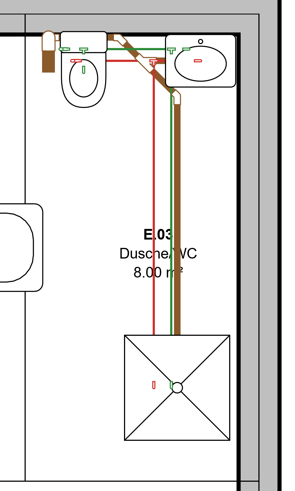
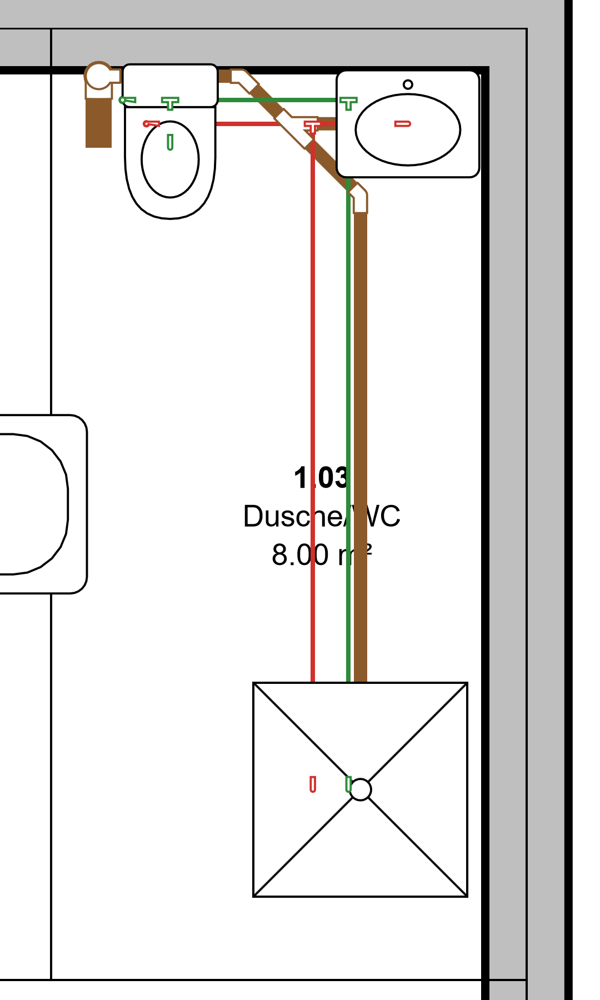
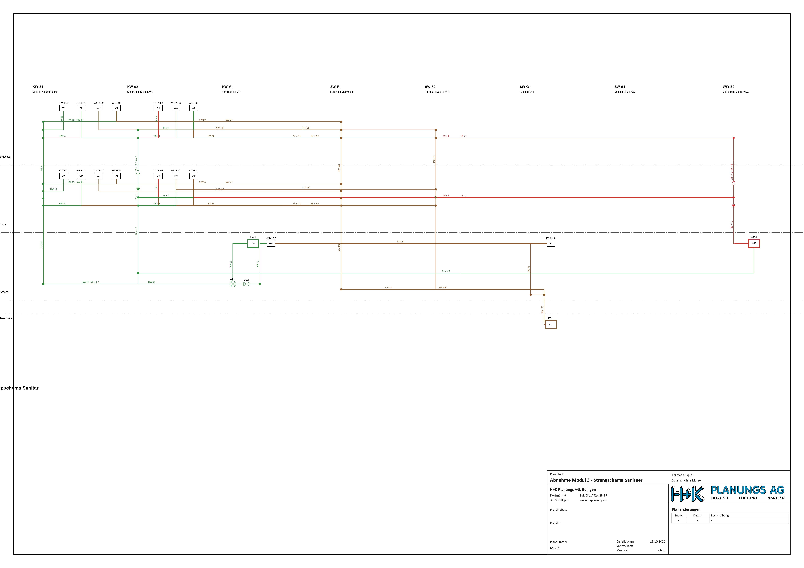

# Testbericht Modul 3 – Leitungen und Schema (ENTWURF)

Stand 19.10.2026 · gebaut am 18./19.10.2026 (geplant 25.01.–11.02.2027) · **Abgenommen unter Vorbehalt (Christian, 19.10.2026)**: Nachträge B8 (Strangschema nach Beispiel), B9 (Beschriftung Werkstoff/Ø) und Korrekturen aus Prüfliste 27 und 30; endgültige Freigabe nach Vorführung des neuen Strangschemas

Hinweis: Modul 2 ist abgenommen (18.10.2026). Auf Christians Auftrag vom 18.10.2026, 23:40 («mache bis morgen 8:00 ohne
abnahmen weiter») wurde Modul 3 ohne Abnahme fertig gebaut und Modul 3b begonnen; 3b ist nicht Teil dieses Berichts.
Entwurf von hlks-test, vom Hauptlauf gegengelesen und um die eigenen Läufe (HKAP gegen die Testkopie, Abnahmeprojekt) ergänzt.

## Ergebnis

Leitungen werden mit Serie und Grösse gezeichnet, KICAD setzt die Formteile selbst (Bogen, T-Stück mit Abzweigwinkel,
Reduktion), kürzt um die Einbaulängen, verbindet alles und rechnet das Gefälle. Das Schema ist eine Ansicht desselben
Modells (Strangschema, Hand-Lagen bleiben). Die Leitungsserien für die Abnahme hat die KI aus Herstellerunterlagen
gebaut (vier echte Serien, alle noch Entwurf). HKAP kennt jetzt die Datenart «straenge» (Testkopie, nicht ausgeliefert).
Alle Zahlen unten stammen aus meinen Läufen vom 19.10.2026 bzw. aus `zuteilung.md` und sind so gekennzeichnet.

| Kriterium (Spezifikation `entwurf/modul-3.md`) | Nachweis |
| --- | --- |
| 1 Sanitärstrang mit echten Serien, Formteile automatisch, alles verbunden, Gefälle; Grundriss, 3D, Schema gleich | Abnahmeprojekt `%USERPROFILE%\HLKS_CAD_build\abnahme3` (Skript `werkzeuge/abnahme3_sanitaer.ps1`, Hauptlauf): 58 Schritte, **94 Elemente**, 36 Altbestandselemente ersetzt, **0 Befunde P13–P18, 0 offene Anschlüsse**, Materialliste je Strang. Echte Serien: Geberit Mapress Edelstahl (22 × 1.2 / 18 × 1) und Geberit Silent-db20 (110 × 6 / 56 × 3.2). Dasselbe Szenario läuft mit fiktiven Serien als C#-Test (20/20). Bilder unten. Der Skriptlauf mit Prüfbefunden und Materialliste ist vom Hauptlauf; hlks-test hat das Abnahmeprojekt nur über Bilder beurteilt, «Änderung an einer Stelle erscheint überall» (Abdeckung: Kern- und Browser-Tests der Agenten, kein eigener Nachweis am Abnahmeprojekt). |
| 2 Stränge in HKAP (Datenart «straenge», Testkopie) | Hauptlauf, Phase H: Testkopie 5098, **20/20 Prüfungen** (Lesen, Trockenlauf, Neuanlage mit Nummer S_01, **gleicher Inhalt = unverändert**, Konflikt, Ablehnungen), Anzeige im HKAP-Editor geprüft. Heizung H_01 mit VL + RL: im Kern-Test belegt (`HkapStraengeTests`: «H_01-HZ-VL»/«H_01-HZ-RL» als gebündelte KICAD-Stränge, 29 + 6 Tests, alle grün in meinem Lauf). Das zweite Senden «unverändert» ist ebenfalls getestet. **Hauptlauf gegen die Testkopie 5098 (19.10.2026):** `HkapTestkopieTests` 2/2 – neuer Test: Heizung VL + RL als **ein** HKAP-Strang «H_01 Heizung» mit beiden KICAD-Strängen und je 3.0 m DN 20, zweites Senden «Nichts zu senden», Abgleich danach leer; `hkap.browser.mjs` **83/83** mit frischer Datenkopie, Abgleich-Dialog mit der Datenart «Stränge». **Nicht ausgeliefert** (Freigabe Christian, zusammen mit 1d). |
| 3 Masse und Lagen = Handrechnung | **B6: 119 Referenzfälle von Hand** (Einbaulängen, Bogenlagen, Routing-Längen, Gefälle/Toleranz, Mengen, Schema-Raster, Kanal, `verbinden`-Grenzen), alle grün, kein Befund am Kern. Dazu Handrechnungen der Agenten, vom Hauptlauf nachgerechnet (B1: 20.711, 37, 31, 16.077 mm; B2: 1950/1450 mm, 60 mm Gefälle, 77 mm Abzweig; B4: 65 mm, 12.5 mm, 4.45 m; B3: Raster 30/100, 40/110, 55/125). **Abnahmeszenario Fallstrang/Anschlussleitungen auf 0.005 mm** (hlks-kern). Stichprobe Hauptlauf: arctan 0.87 % = 0.498°, 0.88 % = 0.504°. |
| 4 MCP, Trockenlauf, rückgängig, Prüfungen | MCP-Werkzeuge für Leitungen, Schema, Materialliste je mit Trockenlauf und Rückgängig (Tests je Agent); Prüfungen **P13 Lage, P14 Grössensprung, P15 Knick/Winkel, P16 Gefälle, P17 nur im Schema, P18 ohne Serie** in `Pruefungen.Codes`, im Abnahmeszenario 0 Befunde. MCP-Reihe: 33 von 38 grün, die 5 Fehlschläge gehören zu 3b (siehe unten). |

## Bilder des Abnahmeprojekts (19.10.2026, synthetische Daten, Hauptlauf)

Grundriss EG, Dusche/WC mit Mapress (grün Kaltwasser, rot Warmwasser) und Silent-db20 (braun, Fall mit Formteilen):

Grundriss 1. OG:

Strangschema Sanitär (Planblatt M3-3, A2; Spalte je Strang, Zeile je Geschoss):

Planblatt M3-1 (Grundriss 1. OG) als PDF: [M3-1-grundriss-1og.pdf](modul-3/M3-1-grundriss-1og.pdf).

**Mängel auf den Bildern (von mir gesichtet, im Protokoll schon als Befund geführt):**
- Schema auf A2 zu breit: Titel («…ipschema Sanitär») und Geschossnamen links werden abgeschnitten.
- Grundriss: die Raumbeschriftung «E.03 Dusche/WC» wird von Leitungen überdeckt.
- Im Schema liegen mehrere Linien (Kalt-/Warmwasser, Abwasser) eng nebeneinander und überdecken sich teils an den Knoten;
  Grössenbeschriftungen stehen nicht an jeder Linie (Regel: nur am längsten Abschnitt ≥ 12 mm).
- Die Hersteller-Darstellung der Formteile im Grundriss (Bögen, T) ist erkennbar, aber nur im Bild beurteilt, nicht gemessen.

## Gebaute Teile, Agent, Ergebnis (aus `zuteilung.md`)

| Teil | Inhalt | Agent | Ergebnis |
| --- | --- | --- | --- |
| A | Spezifikation, Datenmodell, fiktive Testserie, Einhängepunkte | Hauptlauf | ok (drei Tests nahmen «Rohr» als nicht familienfähiges Beispiel → angepasst) |
| B1 | Leitungsserien, Formteilwahl, Ausrichtung, Anschlusslagen, `verbinden` streng, P13–P15, P18 | hlks-kern | ok, 85 neue Tests, keine Nacharbeit |
| B3 | Schema-Kern: Anordnung, SchemaGrafik, Lagen, nicht platzierte Elemente, P17 | hlks-kern | ok, 75 Tests, keine Nacharbeit |
| B2 | Routing: zeichnen, abzweigen, aufteilen, Grösse/Serie, Gefälle, Nachführung, P16 | hlks-kern | ok, 42 Tests, keine Nacharbeit |
| B4 | Darstellung massstäblich, Dämmung, Schnitthöhe, Mengen, Materialliste | hlks-modul | ok, 33 Kern- + 2 MCP- + 4 Node-Tests, keine Nacharbeit |
| H | HKAP-Datenart «straenge» (HKAP-Code) | Hauptlauf | ok, 20/20 Testkopie |
| B5 | KICAD-Seite «straenge» (Abbildung, Abgleich, Platzhalter) | hlks-modul | ok, 35 Kern-Tests, keine Nacharbeit |
| C2 | Schema-Ansicht in der Oberfläche | hlks-modul | ok, 36 Node + 93 Browser neu, keine Nacharbeit |
| C1 | Oberfläche Leitungen (Werkzeuge, Fang, Optionsleiste, Griffe) | hlks-modul | ok, 45 Node + 114 Browser neu, keine Nacharbeit |
| C3 | Editor für Leitungsserien, Fangkanten, Materialliste im Dialog | hlks-modul | ok, 21 Node + 70 Browser neu, keine Nacharbeit |
| B6 | Referenzfälle von Hand | hlks-test | ok, 119 Tests, kein Befund am Kern, keine Nacharbeit |
| B7 | Abzweigwinkel (Spezifikationslücke), Abwasser-Testserie | hlks-kern | ok, 24 Tests, keine Nacharbeit; Entscheid Winkeltoleranz ±1° |
| D-Vorb. | Abnahmeszenario Sanitärstrang (C#-Test + Skript) | hlks-kern | ok, 20/20, keine Nacharbeit |
| D | Sanitärstrang echte Serien, vier KI-Läufe, dieser Bericht | Hauptlauf / hlks-test | siehe oben und unten |

## Automatische Tests (meine Läufe 19.10.2026, `HLKS_BUILD = …\m3d`, Maschine unter Last durch Modul 3b)

| Reihe | gesamt | grün | Fehlschläge | Einordnung |
| --- | --- | --- | --- | --- |
| Kern (`Hlks.Kern.Tests`), Erstlauf (23 min 45 s) | 3236 | 3230 | 6 | alle 6 reine Zeitgrenzen, **einzeln wiederholt: alle grün** (siehe unten) |
| Kern nach Wiederholung | 3236 | **3236** | 0 | übersprungen 0 |
| MCP (`Hlks.Mcp.Tests`) | 38 | 33 | **5** | alle 5 **Modul 3b** (Werkzeugregister) |
| Web (`Hlks.Web.Tests`) | 148 | 146 | **2** | beide **Modul 3b** (Abfrageliste) |
| **Total C#** | **3422** | **3415** (nach Wiederholung der Zeitgrenzen) | 7 | alle 7 gehören zu 3b, keiner zu Modul 3 |
| Node (alle 14 `*.test.mjs`, `node --test`) | 412 | **403** | 0 | 9 übersprungen: brauchen `HLKS_TEST_SERVER` bzw. einen laufenden Server («Echter Kern», «Server: …») – nicht mit meinen Mitteln ausführbar |
| Kern, nur Modul-3-Klassen (Filter nach Name: Referenz3, Routing, Schema, Leitung, Anschlusslagen, Ausrichtung, Abnahme3, Darstellung3) | 821 | **821** | 0 | Namensfilter, enthält auch ältere Tests gleichen Namens; keine genaue Modul-3-Zählung |

Vergleich Modul 2: Kern 2642, MCP 30, Web 148, Node 294.

**Zeitgrenzen im Kern-Erstlauf (unter Last, einzeln wiederholt):**

| Test | Meldung im Erstlauf | Wiederholung |
| --- | --- | --- |
| `IfcHlksEchtTests.BkwHauptsitz_HeizungKaelte_Nova` | Dauer 2:58 (Grenze 60 s), Zeile 71 | grün |
| `IfcHlksEchtTests.Bernstrasse42_Revit2025_Ifc2x3` | Dauer 4:24 (Grenze 120 s), Zeile 131 | grün |
| `RaumgrenzenEchtTests.Bkw_AlleRaumgrenzen_Dauer_Summen` | 16.5 s (Ziel unter 10 s), Zeile 138 | 1. Wiederholung 11.2 s (noch unter Last), 2. Wiederholung grün |
| `IfcEchtRauchTests.Pruefen_…_Dauer` ×3 (hlks_hk_2026-02-10, architekt_3d, hlks_hk_2024-09-17) | 272.1 s / 112.7 s / 76.4 s | hlks_hk_2026-02-10 1. Wiederholung 71.6 s (zu langsam), 2. grün; die beiden anderen grün |

Das sind Tests der Module 1b/1c, keine Modul-3-Tests. Die Zeitgrenzen sind lastabhängig; die inhaltlichen Prüfungen
dieser Tests (Zahlen, Klassen) sind nicht gescheitert.

**Fehler in Modul-3b-Dateien (nicht Modul 3), Stand B2/B3 «läuft» im Protokoll:**

| Test | Meldung | Ursache (vermutet) |
| --- | --- | --- |
| `Hlks.Mcp.Tests.ProtokollTests.Server_ListetAlleWerkzeugeUndBeantwortetProjektUeberblick` | Collections differ, erwartet u. a. `aussparung_status`, `aussparungen_abgleichen`, `aussparungen_nummerieren` | Werkzeuge von 3b B3 im Kern, aber noch nicht (oder nicht vollständig) im MCP-Register/Testliste |
| `WerkzeugTests.Abfragen_JedeLiefertNichtLeerOhneFehler` | Collections differ, `aussparungsliste`, `bcf_export`, `bcf_lesen` | wie oben |
| `WerkzeugTests.Abdeckung_BefehlParameterUndBeschreibungenStimmenMitDemRegister` | `KeyNotFoundException` «vorgaben_setzen» | 3b B2: Befehl im Register, Parameter-/Beschreibungstabelle fehlt |
| `WerkzeugTests.Abdeckung_AbfrageParameterUndBeschreibungenStimmenMitDerListe` | `KeyNotFoundException` «kollisionen» | 3b B2: Abfrage ohne Tabelleneintrag |
| `WerkzeugTests.Abdeckung_WerkzeugnamenSindGenauAbfragenBefehleUndVerlauf` | Collections differ ab `aussparung_status` | wie oben |
| `Hlks.Web.Tests.ApiTests.Abfrage_JedeAusDerListeLiefertJsonBzwTextOhneFehler` | `KeyNotFoundException` «kollisionen» | wie oben |
| `ApiTests.Abfragen_ParameterTabelleDecktGenauDieListeAb` | Collections differ ab `aussparungsliste`, `bcf_export` | wie oben |

Diese Tests prüfen, dass Register, Beschreibungstabellen und Abfrageliste deckungsgleich sind; sie werden grün, sobald
3b B2/B3 ihre Einträge nachziehen. Ich habe nichts angepasst. **Nach Abschluss von 3b MCP und Web erneut laufen lassen.**

### Browser-Reihen (nicht von mir gestartet, Zahlen aus den Agentenberichten in `zuteilung.md`)

| Reihe / Teil | neu | Stand |
| --- | --- | --- |
| C2 Schema-Ansicht (Zeichnen, Hand-Lagen, verbinden/trennen/einfügen, Im Grundriss zeigen, Planblatt) | 93 | alle grün, übrige Reihen grün |
| C1 Leitungen (Werkzeuge, Optionsleiste, Fang 3D, Höhenwechsel, Abzweig, Griffe, Palette) | 114 | alle grün; `hkap.browser` damals offen |
| C3 Editor Leitungsserien, Fangkanten, Materialliste | 70 | alle grün |
| `hkap.browser.mjs` gegen Testkopie 5098 (Hauptlauf, frische Datenkopie, Server 5142) | – | **83/83** (Stränge im Abgleich) |

Gesamtzahl je Reihe (wie 603 in Modul 2) liegt mir für Modul 3 nicht vor; die neuen Prüfungen summieren sich auf 277.
Ich habe die Reihen nicht selbst wiederholt und kann sie nicht bestätigen.

## KI-Läufe der vier echten Serien (19.10.2026, über Christians Abo, mit Internet, Freigabe Christian 19.10.2026)

Quelle: `zuteilung.md` und die Berichte der KI unter `…\abnahme3\e_KICAD\auftraege\`. Alle 16 Familien sind **Entwurf**,
nichts ist freigegeben. Werte oder Preise aus den Herstellerunterlagen sind hier absichtlich nicht wiedergegeben.

| Lauf | Serie | Dauer | Familien | Befunde / Besonderheiten |
| --- | --- | --- | --- | --- |
| 1 | Geberit Mapress Edelstahl (CH) | 14 min | FAM-1..4: Bogen, T-Stück, Reduktion, Rohr; Winkel 15/30/45/60/90° | Konflikte statt stiller Werte; Befund: Werkzeug `leitungsserie` war der KI gesperrt (nur lesen jetzt freigegeben, Vorlage und Test nachgeführt) |
| 2 | Geberit Mapress C-Stahl (DE) | 11 min | FAM-5..8, Winkel 45/90° | Masse 100 % in Toleranz; einige Reduktionspaare fehlen |
| 3 | JRG Sanipex MT (GF, Seite CH) | 7 min | FAM-9..12 | Masse in Toleranz; `abzweigwinkel` vom alten Serverstand abgelehnt → Server mit B7 neu gebaut; Nachtrag: GF führt auch Sanipex classic, nicht gebaut |
| 4 | Geberit Silent-db20 (CH) | 14 min | FAM-13..16: Bögen 15/30/45/67/88.5°, Abzweige 45°/88.5° (auch reduziert), Reduktionen nur für d 110 | Serie mit `abzweigwinkel [45, 88.5]`; DN aus der Geberit-CH-Tabelle belegt; Masse in cm mit Befund-Id und Faktor 10 |

Zur Quellenlage (aus dem KI-Bericht von Lauf 1): Einzelne Geberit-Datenblätter waren nur über **Händlerserver** erreichbar
(Ablage mit Vermerk «Erstellt mit Geberit Produktdaten», Werbeseite eingefügt); aus der Werbeseite wurde nichts
übernommen. Beim Hersteller selbst sind die PDFs nur über eine Schaltfläche erhältlich. Keine Unterlage war nur mit Anmeldung
erhältlich. **Ob Christian Händlerablagen als Quelle akzeptiert, ist offen** (Prüfliste 14).

Im Abnahmestrang verbaut sind die Serien Mapress Edelstahl und Silent-db20. C-Stahl (Heizung) und Sanipex sind als
Familien gebaut, im Strang aber nicht benutzt.

## Entscheide und Annahmen für Christians Prüfliste

Aus `entwurf/modul-3.md` («Entscheide während des Baus», Prüfliste 0–7), nummeriert, je eine Frage.

1. **Serien:** Geberit Mapress Heizung (C-Stahl), Mapress Sanitär (Edelstahl), **JRG Sanipex MT** statt «JRG PEX», Geberit Silent-db20: sind das die richtigen Produkte (Sanipex MT, nicht classic; Material C-Stahl bzw. Edelstahl war Annahme)?
2. **Freigabe der 16 Familien:** Jede Familie (FAM-1..16) ist Entwurf; bitte prüfen und freigeben, offene Konflikte entscheiden (Konfliktliste in der Prüfansicht).
3. Ein **Leitungselement je Gerade**, Formteile mit Einbaulänge (Revit-Verhalten); bestehende Polylinien bleiben und werden mit `leitung_aufteilen` umgebaut. Einverstanden?
4. **Leitungsserie = Familie** der Kategorie Rohr/Kanal, Grössen als Typen. Einverstanden?
5. **Winkeltoleranz ±1°** (vorher ±0.5°; deckt 90° bis 1.75 % Gefälle, 88.5° 0.87–4.37 %). Reicht das, oder sollen nur Winkel aus der Serie ganz genau passen?
6. `verbinden` verlangt Lage ≤ 1 mm, gegenläufige Richtung, gleiches Medium und Grösse; sonst Ablehnung mit Vorschlag. Streng genug, zu streng?
7. **Direkt an der Toleranzgrenze (≈ 1°)** kann `verbinden` wegen Rundung ablehnen. Hinnehmen?
8. **Schema:** Strangschema mit Spalte je Strang und Zeile je Geschoss; die Anordnung wird bei jedem Lesen gerechnet, nur Hand-Lagen werden gespeichert. Passt das?
9. **Raster des Strangschemas** (Rand 30, Spalte 70, Zeile 50, Schriften 1.6–2.5 mm Papier). Zu eng/zu weit, Schriftgrössen?
10. **Schnitthöhe nur für Leitungen mit Serie** (oberhalb gestrichelt, Steigleitung als Ring); soll das auch für den Altbestand aus IFC gelten (dann z. B. Kanäle unter der Decke gestrichelt)?
11. **Gefälle in %** entlang der Leitung, P16 mit Toleranz 0.1 %-Punkte, nur für Leitungen mit Serie, Fallstrecken ≥ 45° ausgenommen. Richtig?
12. **Gefälle nur auf waagrecht gezeichneten Stücken**, ab dem Anfang (bzw. Ende, wenn nur dieses gebunden ist); ≤ 1 mm zwischen Formteilen = direkt verbunden. Gewollt?
13. **Abzweigwinkel:** T-Stück-Familie mit Parameter `winkel`, Serie nennt `regeln.abzweigwinkel` (Vorgabe [90]); bei w < 90 zeigt der Abzweig gegen die Durchgangsrichtung. Stimmt das mit Abwasser-Abzweigen überein?
14. **Quellen aus Händlerablagen** (Geberit-Datenblätter bei Händlern statt beim Hersteller): akzeptiert, oder nur Herstellerseiten?
15. **Masse in cm vom Hersteller** werden als cm mit Faktor 10 geführt (Befund-Id bleibt auf der Quelle). Recht so?
16. **DN-Zuordnung** nur nach Herstellertabelle (nie aus dem Aussendurchmesser abgeleitet); bei Silent-db20 weicht DN 56/60/70 vom Aussendurchmesser ab. In Ordnung?
17. **Dämmung** im Grundriss ab Detailgrad mittel (zwei gestrichelte Ränder), in 3D nur fein; Rohr mit Serie als Band in Medienfarbe ohne Kontur. Gefällt die Darstellung?
18. **Beschriftung** mit Serie = Typname («DN 20»), Kanäle weiter b×h bzw. Ø d; im Schema Grössen nur am längsten Abschnitt ≥ 12 mm. Reicht das?
19. **Endgerät an mehreren Systemen** steht im Schema am ersten Strang in Spaltenreihenfolge; Quelle/Senke/Zentrale wie Endgeräte. Soll es an jedem Strang erscheinen?
20. **Prinzipschema** in Modul 3 wie Strangschema angeordnet (Hinweis); richtiges Prinzipschema Heizung in Modul 5, Lüftung in Modul 6. Zurückstellen in Ordnung?
21. **Nachführung:** Leitungsenden folgen Geräten und Formteilen; Formteile folgen nicht einer verschobenen Leitung (Hinweis «Ende folgt»). Gewollt?
22. **Rechteckkanal:** Bögen mit b in der Biegeebene; Steig-/Fallbögen drehen den Querschnitt, «hochkant»-Typen und Grössenvergleich mit Lage kommen mit Modul 6. Zurückstellen?
23. **Schema-Hand-Lagen** auf 0.5 mm gerundet mit Einrasten (8 px) auf Stranglinien; beim Einfügen bekommt ein Endgerät den Strang der Spalte. Handhabung?
24. **HKAP:** ein HKAP-Strang bündelt mehrere KICAD-Stränge (Heizung = VL + RL; Sanitär = KW, WW, Zirkulation, SW); Medium «wer zuerst», KICAD überschreibt nie einen HKAP-Wert; Sole ohne Medium (offen). Einverstanden, und **Auslieferung der HKAP-Änderung** (zusammen mit 1d) freigeben?
25. **Strangbündelung beim Senden** (`buendeln` auto: gleicher Name im selben Medium, dann gleiche Nummer am Kennzeichen-Ende). Passt das zu euren Kennzeichen?
26. **Prüfungen:** P18 meldet jede Leitung ohne Serie als Hinweis (im Beispielprojekt je Rohr einer); P17 meldet nur im Schema stehende Elemente. Zu laut?
27. **Abwasserleitungen des Beispielprojekts** widersprechen ihrem Gefälle (z. B. SW-G1-2 0.27 % statt 1 %): Beispielprojekt korrigieren (offen, Hauptlauf) oder so lassen?
28. **Nicht platzierte Elemente** (nur im Schema) zulassen für Endgeräte, Armaturen, Formteile, Leitungen. Richtig, oder nur für Geräte?
29. **Koordinaten BCF** (projekt/ifc): gehört zu **3b**, nicht zu Modul 3 – hier nur erwähnt, damit die Frage nicht verloren geht.
30. **Formteile nachträglich zugeordnet** (`familie_platzieren` ohne `teilVon`); **Materialliste** zählt T-Stücke nicht je Abzweigwinkel. Zurückstellen?

### Antworten Christian (Abnahme ab 19.10.2026)

| # | Antwort | Folge |
| --- | --- | --- |
| 1 | Serien bestätigt: Mapress C-Stahl (Heizung), Mapress Edelstahl (Sanitär), JRG Sanipex MT, Geberit Silent-db20 | Annahmen Material und «MT» bestätigt |
| 2 | Familien freigeben später, separat | offen (eigener Schritt) |
| 3–7 | wie empfohlen: ein Element je Gerade, Serie = Familie, Winkeltoleranz ±1°, `verbinden` streng, Rundung an der 1°-Grenze hinnehmen | keine Änderung |
| 8, 9, 19, 23 | Erläuterung Strangschema («Übersicht, nicht massstäblich, Reihenfolge der Abgänge wie im System, strangweise») mit Beispiel Bernstrasse (Schema Wasser/Abwasser); Abgänge nach Lage im Netz, Stränge nach Lage im Gebäude, Medien im Bündel nach realer Lage, Zugehörigkeit nur von Hand, Wohnungsblock mit Tabelle, Dämmung jetzt, Belastung mit Modul 4 | **Nachtrag B8** (Umbau Strangschema), läuft |
| 10 | (a) über der Schnitthöhe ausgezogen, gestrichelt nur Verdecktes | vom Hauptlauf umgesetzt (`HlksGrafik`): verdeckt = ganz unter der Kote des dargestellten Geschosses (Auslegung, Prüfliste), für alle Leitungen; Schnitthöhe nur noch für die Füllung der Steigleitungen; 422 Tests grün |
| 11–13 | wie empfohlen: Gefälle in %, P16-Toleranz 0.1 %-Punkte, nur waagrechte Stücke; Abzweig unter 45°/88.5° mündet in Fliessrichtung | keine Änderung |
| 14 | Händlerablagen akzeptiert, wenn unverändert vom Hersteller und Quelle vermerkt | Regel für die KI-Läufe (`ki/familie_aus_unterlagen.md`) |
| 15–17, 20, 21 | wie empfohlen: cm-Masse mit Faktor 10, DN nur aus der Herstellertabelle, Darstellung Band/Dämmung, Prinzipschema mit Modul 5/6, Nachführung «Ende folgt» | keine Änderung |
| 18 | Beschriftung wie in Christians Schemas: **Werkstoff-Kürzel und Aussendurchmesser** («CNS Ø22», «PE-S Ø110», «PEX Ø16»), im Schema und im Grundriss | **Nachtrag B9** (Kürzel in der Leitungsserie, Leitungsbezeichnung, Familieneditor, KI-Anleitung), läuft |
| 19 | durch B8 ersetzt (Endgerät im Bündel seiner Steigzone) | B8 |
| 22 | Rechteckkanal (Hochkant-Typen, Grössenvergleich mit Lage) auf Modul 6 | zurückgestellt |
| 23 | Hand-Lagen im Schema mit Einrasten, Endgerät bekommt den Strang, auf dem es einrastet – gilt auch für die Bündel | B8 |
| 24 | HKAP-Strang bündelt KICAD-Stränge, Medium «wer zuerst», HKAP-Werte nie überschreiben – ja; **Auslieferung separat mit 1d** | offen bei Christian (Freigabe) |
| 25 | Bündelung für HKAP über die **Steigzone** (von Hand), wie im Schema; ohne Steigzone je KICAD-Strang ein HKAP-Strang | vom Hauptlauf umgesetzt (`buendeln` Vorgabe `steigzone`, übrige Arten auf Wunsch) |
| 26 | P18 je Strang zusammenfassen (eine Meldung mit Anzahl), P17 bleibt | vom Hauptlauf umgesetzt (Strang, sonst System, sonst einzeln; ungültige Serie weiter je Leitung) |
| 27 | Abwassergefälle im Beispielprojekt korrigieren | **erledigt** 19.10.2026: 14 Leitungsgruppen auf Sollgefälle, Test «Gefälle stimmt» (BeispielGefaelleTests) |
| 28 | Nicht platzierte Elemente (nur im Schema) für alle zulassen, P17 erinnert | keine Änderung |
| 29 | BCF-Koordinaten: beide wählbar (Antwort zu 3b) | erledigt in 3b |
| 30 | Materialliste je Abzweigwinkel; einzeln platzierte Formteile übernehmen den Strang der angeschlossenen Leitung | **erledigt** 19.10.2026: T-Stück mit Abzweigwinkel; Strang beim Verbinden (Durchgang a/b entscheidet, sonst Hinweis) |
| Vorführung B8 | Strangschema nach Beispiel (Bilder `modul-3/strangschema-b8-wasser.png`, `-abwasser.png`, fiktives Testhaus): **passt**; Feinheiten beheben (überlappende Beschriftungen in Verteilleitungen, Übergang Warmwasser–Zirkulation); **Apparate als Sinnbilder** wie in Christians Schema Abwasser statt Kästchen | Nachtrag B8b (nach den Korrekturen 27/30) |
| **Abnahme** | **unter Vorbehalt** der Nachträge B8, B9 und der Korrekturen 27 und 30; endgültige Freigabe nach Vorführung des neuen Strangschemas | offen |
## Offene Punkte und Nachbearbeitung

| # | Punkt | Wer / wann |
| --- | --- | --- |
| 1 | MCP 5 und Web 2 Fehlschläge (Register/Abfrageliste 3b) nach Abschluss von 3b erneut prüfen | Hauptlauf, nach 3b |
| 2 | ~~HKAP-Browser-Reihe gegen die Testkopie~~ – erledigt 19.10.2026 (83/83) | Hauptlauf |
| 3 | HKAP-Auslieferung «straenge» (zusammen mit 1d) | Christian |
| 4 | Schema auf A2: Titel und Geschossnamen abgeschnitten; Raumbeschriftung im Grundriss von Leitungen überdeckt | Hauptlauf / hlks-modul |
| 5 | Beispielprojekt: Abwassergefälle (P16) und P18-Hinweise je Rohr | Hauptlauf |
| 6 | Offen aus den Teilen: `familie_aendern` ohne `schemasymbol_setzen`; Linien im Schema höchstens ein Knick; Laufzeit auf grossen Modellen; Param.Punkt trennt «WC-E.02» am letzten Punkt; `familie_platzieren` ohne Punkt; Mehrdeutigkeit beim Verbinden nur im Text; schräges T am Rand eines Zugs bei `leitung_serie`/`leitung_groesse`; Rechteck-T mit Winkel (Modul 6) | siehe `entwurf/modul-3.md` |
| 7 | Familien FAM-1..16 prüfen und freigeben; einzelne fehlende Reduktionspaare (Lauf 2), Silent-db20-Reduktionen nur für d 110 | Christian |
| 8 | Browser-Bildschirmfotos im App-Fenster werden abgeschnitten (Werkzeug), Bilder deshalb aus Planblättern und Ausschnitten | Hauptlauf |

## Bekannte Grenzen dieser Prüfung

- Browser-Reihen der Agenten und die 9 übersprungenen Node-Tests (Server nötig) hat hlks-test nicht ausgeführt; `hkap.browser` und den HKAP-Testkopie-Lauf hat der Hauptlauf ausgeführt (siehe Kriterium 2).
- Das Abnahmeprojekt `abnahme3` habe ich nur über die Bilder, den Zuteilungseintrag und die KI-Berichte beurteilt, nicht im Kern neu gerechnet und nicht per Prüfung P13–P18 nachgemessen.
- Normwerte und Herstellerwerte habe ich weder geprüft noch in diesen Bericht übernommen.
- Die Zeitgrenzen-Tests sind mit der Maschinenlast nicht reproduzierbar belegt (zwei Wiederholungen nötig); eine Messung auf ruhiger Maschine steht aus.
- Die Namensfilter-Zählung (821) ist keine exakte Modul-3-Testzahl.

## Auswertung der Zuteilung (Modul 3)

Bauaufträge an Agenten: **13** (hlks-kern 5: B1, B3, B2, B7, D-Vorbereitung; hlks-modul 5: B4, B5, C1, C2, C3; hlks-test 1: B6;
Hauptlauf selbst: A, H, D sowie die vier KI-Läufe). Nacharbeit: **keine** bei allen 11 Agentenaufträgen. Die Nachträge (B7,
C3, die Abnahmeläufe) kamen aus Lücken in der Spezifikation oder im Code des Hauptlaufs: Abzweigwinkel fehlte in der
Spezifikation, zwei B1-Tests widersprachen der gewollten Nachführung (Hauptlauf angepasst), drei Tests mit «Rohr» als
nicht familienfähiges Beispiel, Werkzeug `leitungsserie` war für die KI gesperrt, Server mit altem Stand bei Lauf 3.
Hauptlauf-Zeilen lagen teils nicht in der Phasentabelle (B7, C3, D-Vorbereitung): Tabelle gegen `zuteilung.md` abgleichen.

**Nach der Regel «zweimal Nacharbeit → höher, dreimal ohne → probeweise tiefer»** (Vorschlag hlks-test, eine Änderung vom Hauptlauf umgesetzt):

| Aufgabenart | Stand | Vorschlag |
| --- | --- | --- |
| Rechenkern/Geometrie (hlks-kern): B1, B2, B3, B7 ohne Nacharbeit | Regel würde «tiefer» auslösen | **bleibt** (fachlich teuer: Einbaulängen, Gefälle, Winkeltoleranz; dieselbe Begründung wie in 1c und 2) |
| Oberfläche (hlks-modul): C1, C2, C3 ohne Nacharbeit | mechanik ungeeignet (eigene Entscheide) | **bleibt** |
| Routinebau im Kern / Adapter nach Spezifikation (hlks-modul): B4, B5 ohne Nacharbeit; Adapter-Probe: 1c B4, 2 B2, 3 B5 dreimal ohne | Probe seit 18.10.2026 | **umgesetzt vom Hauptlauf 19.10.2026:** Import-/Export-Adapter **fest** bei hlks-modul (CLAUDE.md-Tabelle angepasst) |
| Testfälle schreiben (hlks-test): B6 ohne Nacharbeit, 2 Erwartungen an dokumentiertes Verhalten angepasst, kein Befund | fest seit 18.10.2026 | **bleibt** |

Im Gesamtlauf dieses Berichts (hlks-test, sonnet/medium): Testläufe auswerten ging ohne Nachfragen; die Abgrenzung
3b / lastbedingt gegenüber inhaltlichen Fehlern hat die Prüfung der Meldungen im Einzelnen gebraucht.
